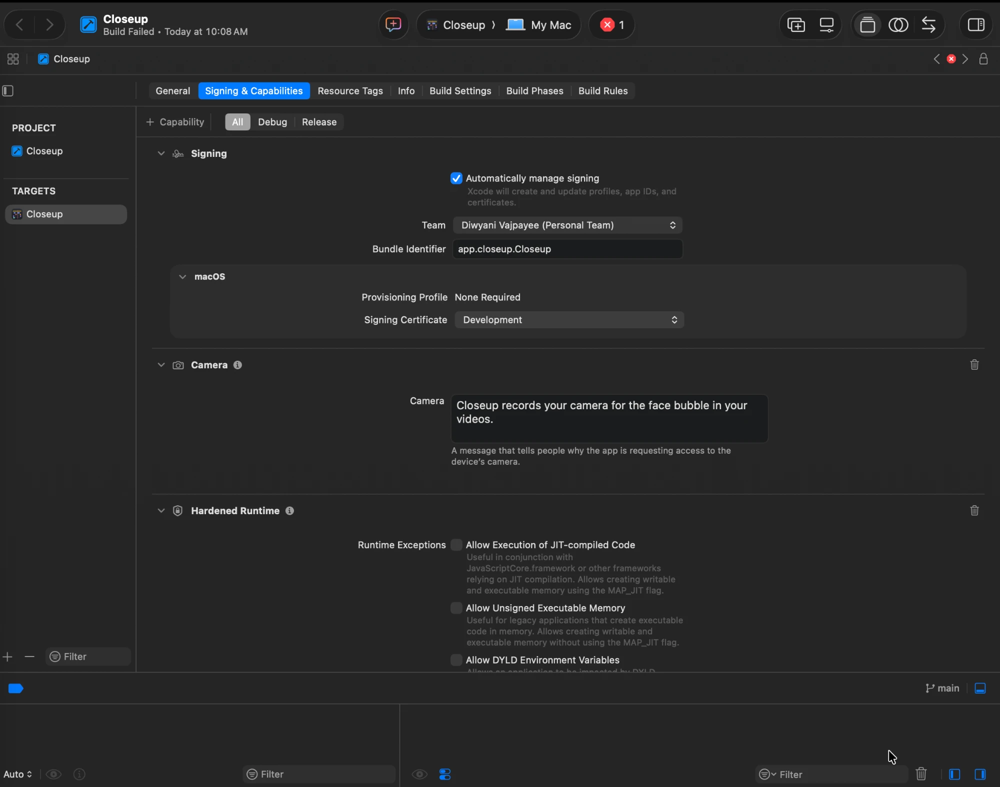
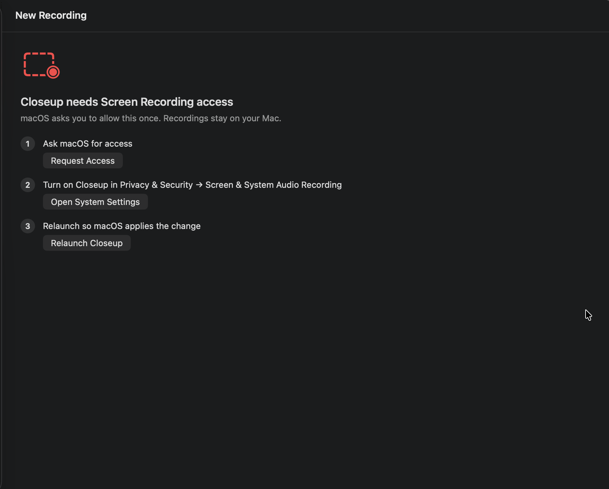
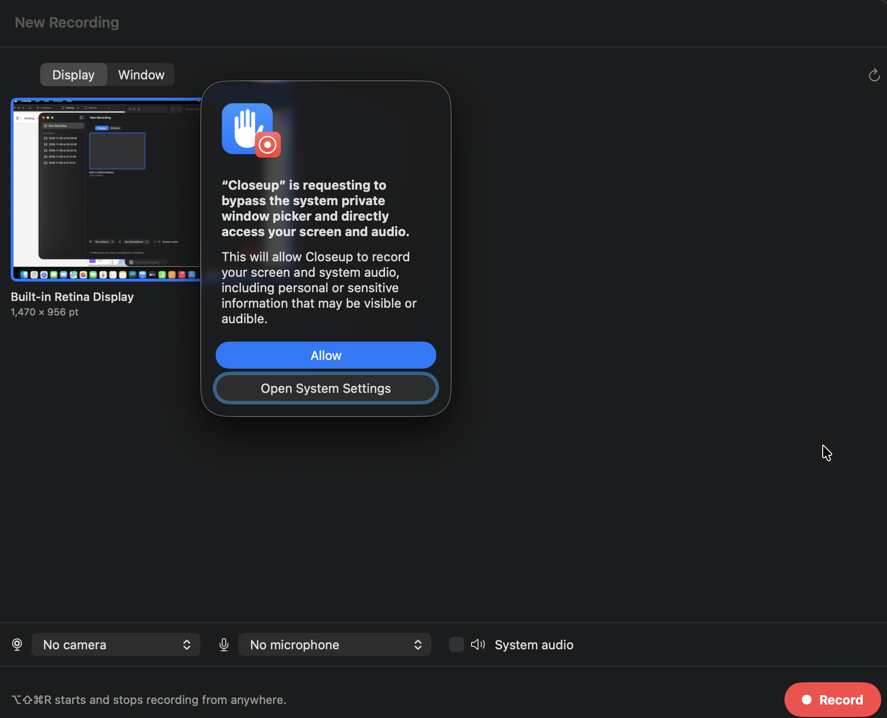
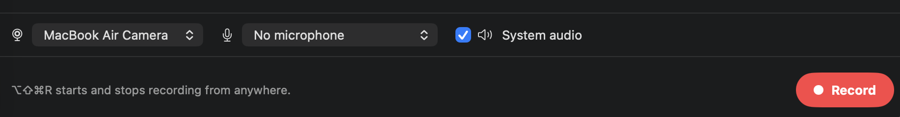

# Install Closeup

A step-by-step guide for anyone, no coding needed. It takes about 15 minutes, plus the time to download Xcode.

Why Xcode? Closeup doesn't have a one-click download yet. You build it yourself with Xcode, Apple's free app for making Mac apps. You only click buttons; you won't write any code.

Prefer to watch? [The video walkthrough](https://youtu.be/JUKBqO_KQok) shows every step.

## What you need

- A Mac with **macOS 14 (Sonoma) or later**. To check: Apple menu  → **About This Mac**.
- About **40 GB free space** for Xcode.
- An **Apple ID** (the one you use for the App Store is fine).

## 1. Install Xcode

1. Open the **App Store**, search for **Xcode**, and click **Get**. It's large, so it can take 30 minutes or more.
2. Open Xcode once. If it asks to install more components, click **Install** and wait.

## 2. Download Closeup

1. Go to [github.com/Diwyani/Closeup](https://github.com/Diwyani/Closeup).
2. Click the green **Code** button → **Download ZIP**.
3. Open the downloaded ZIP (it unzips by itself) and move the **Closeup** folder to your **Documents** folder.

## 3. Open the project

1. In the Closeup folder, double-click **Closeup.xcodeproj**. Xcode opens.
2. If Xcode asks whether to trust the project, click **Trust and Open**.

## 4. Sign in with your Apple ID

1. In Xcode's menu bar: **Xcode → Settings → Accounts**.
2. Click **+** at the bottom left → **Apple ID** → sign in.

## 5. Choose your team

1. In Xcode's left sidebar, click the blue **Closeup** project icon at the very top.
2. Under **Targets**, click **Closeup**, then the **Signing & Capabilities** tab.
3. Leave **Automatically manage signing** ticked.
4. Next to **Team**, choose your name. It says **(Personal Team)** with a free Apple ID.

**If you see "Bundle identifier is not available":** change **Bundle Identifier** (just below Team) to something unique to you, like `com.yourname.closeup`. That's only Closeup's internal name on your Mac.

## 6. Build and open

1. Press **⌘R**, or click the **▶ Run** button at the top left of Xcode.
2. The first build takes a minute or two. Then Closeup opens on its own.

If the top of Xcode says **Build Failed**, click the red error count next to it to see why. It's almost always step 5: no team chosen, or the bundle identifier is taken.

## 7. Allow screen recording

The first time, Closeup shows this screen:

1. Click **Request Access**.
2. Click **Open System Settings**, and turn on **Closeup** under **Privacy & Security → Screen & System Audio Recording**.
3. Click **Relaunch Closeup**.

On newer macOS versions, you may also see this when you first record. Click **Allow**. It means Closeup can record the screen you pick without asking each time.

## 8. Pick your camera and mic

Below the screen picker, choose your **camera** and **microphone**, and tick **System audio** to record what your Mac plays. macOS asks to allow the camera and mic the first time: click **Allow**.

You're ready. Press **Record**, and stop with **⌥⇧⌘R** or the menu bar icon. The editor opens by itself.

## Put it in Applications, then never open Xcode again

Right after step 6, while Closeup is open:

1. In the **Dock**, right-click the **Closeup** icon → **Options** → **Show in Finder**. A Finder window opens with Closeup already selected.
2. Drag that **Closeup** onto **Applications** in the Finder window's sidebar.
3. Quit Closeup and Xcode.

That's it. From now on, open Closeup like any other app: press **⌘ Space**, type **Closeup**, press Return. To keep it in the Dock, right-click its Dock icon → **Options** → **Keep in Dock**.

You only need Xcode again to get a newer version (see below).

## Getting updates

Download the ZIP again (step 2), replace the old folder, press **⌘R** in Xcode, then put the new Closeup in Applications again (replace the old one). Your recordings stay safe in `~/Movies/Closeup`.

## If something goes wrong

| Problem | Fix |
|---|---|
| "No account for team" or "Signing requires a development team" | Do step 4, then pick your team in step 5. |
| "Bundle identifier is not available" | Change it to something unique, like `com.yourname.closeup` (step 5). |
| Build Failed | Click the red error count at the top of Xcode to see the reason. Usually step 5. |
| The recording is black | Screen Recording isn't on yet, or Closeup wasn't relaunched after turning it on (step 7). |
| Closeup won't open after a long time | The signing from a free Apple ID lasts about a year. Open the project, press **⌘R**, and put the new copy in Applications. |
| Can't find "Show in Finder" | Closeup has to be open. Press **⌘R** in Xcode first, then right-click its icon in the Dock. |
| Something else | [Open an issue](https://github.com/Diwyani/Closeup/issues/new/choose) with a screenshot. |
