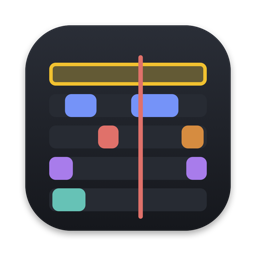

<p align="center">
  
</p>

<h1 align="center">Closeup</h1>

<p align="center">A screen recorder for macOS that turns raw recordings into polished demo videos.<br>
Smooth auto zoom, a tidy cursor, your face, captions. No editing skills needed.</p>

<p align="center">
  <a href="#run-it">Run it</a> ·
  <a href="#how-to-use">How to use</a> ·
  <a href="#how-it-decides">How it decides</a> ·
  <a href="#limitations">Limitations</a> ·
  <a href="CONTRIBUTING.md"><b>Contribute</b></a>
</p>

<p align="center">Open source and free. Fork it, or <a href="CONTRIBUTING.md">send a pull request</a>. I review every one.</p>

<!-- Add your demo video or GIF here -->

## Features

| | |
|---|---|
| **Auto zoom** | Zooms in on clicks and typing and follows the cursor. Every zoom can be moved, resized or removed on the timeline. |
| **Cursor** | Smoothed movement, adjustable size, click glow, motion blur, hides when idle. |
| **Camera** | Live preview while recording. Circle, square, tall or wide bubble in any corner, plus full-screen and side-by-side layouts you can switch on the timeline. |
| **Audio** | Microphone and system audio. Optional voice cleanup: noise removal and even loudness (about −16 LUFS). |
| **Captions** | Generated on your Mac from your voice, with word timing. Edit the text before exporting. |
| **Timeline** | Trim, cuts, speed-ups, camera layouts and text titles. |
| **Smart edits** | Auto-trim dead time at the start and end, speed up long waits, cut short pauses. Never touches anything you're saying. |
| **Look** | Gradient, solid colour or picture background (any image or your wallpaper, with blur and dim). Figma-style colour picker with eyedropper. Padding, rounded corners, shadow. |
| **Export** | MP4 (H.264 + AAC) at a steady 60 fps, 1080p or 4K, in 16:9, 9:16, 1:1 or 4:3. One-click presets for YouTube, X, LinkedIn and Shorts/Reels/TikTok. |
| **Share** | Drag the finished video into any app or browser tab, copy it to paste anywhere, or use the macOS share menu. |
| **Editing comfort** | Changes show instantly while paused. Undo and redo everything with ⌘Z and ⇧⌘Z. |
| **Film Closeup itself** | "Include Closeup" records its own window, for walkthroughs of the app. |

Everything runs on your Mac. No account, no uploads, no third-party code: it's built only on Apple's frameworks.

## Requirements

- macOS 14 or later (captions work best on macOS 26)
- Xcode 26 or later (free on the Mac App Store)

## Run it

1. Download this repository: **Code → Download ZIP**, then unzip it. Or clone it:
   ```bash
   git clone https://github.com/Diwyani/Closeup.git
   ```
2. Open `Closeup.xcodeproj` in Xcode.
3. Select the **Closeup** target → **Signing & Capabilities** → choose your own **Team**. A free Apple ID works.
4. Press **⌘R** to build and run.

## Limitations

Closeup is an early personal project. Right now:

- **No download yet.** There's no ready-to-open app. You need a Mac with Xcode to build it yourself (the steps above take a few minutes). A signed, notarized download needs a paid Apple Developer account, which may come later.
- **Mac only.** It's built on macOS frameworks, so it won't run on Windows, Linux or iPad.
- **Captions** work best on macOS 26. On older versions they need Siri or Dictation turned on in System Settings.
- **Voice cleanup** uses Apple's voice isolation when your Mac has it, and falls back to simpler noise reduction otherwise.
- **Smart edits** use your mouse, keyboard and voice, not what's on screen. A silent wait where something important is loading may be sped up, so check the timeline before exporting.
- **Tested on one Mac** (Apple silicon, macOS 26). If something breaks on yours, please open an issue.

## Contributing

Fork it, change it, make it yours. If you fix a bug or build something others would like, send a pull request and I'll review it.

- **Found a bug or have an idea?** [Open an issue](../../issues/new/choose).
- **Want to contribute code?** Read the [contributing guide](CONTRIBUTING.md) first. It covers forking, branches, the testing checklist and what I look for in a review.

## Permissions

macOS asks for these the first time they're needed:

| Permission | Why |
|---|---|
| Screen & System Audio Recording | To record your screen and the sound your Mac plays |
| Camera | For the face bubble (only if you pick a camera) |
| Microphone | To record your voice (only if you pick a mic) |
| Speech Recognition | To make captions on older macOS versions |

After allowing Screen Recording, quit and reopen Closeup so macOS applies it.

## How to use

1. Pick a display or window, and optionally a camera and microphone.
2. Press **Record** (or **⌥⇧⌘R** from anywhere). A 3-2-1 countdown starts.
3. Stop from the menu bar icon or with **⌥⇧⌘R** again. The editor opens.
4. Adjust the look on the right and edit on the timeline at the bottom.
5. Click **Export MP4**. The file is saved in the recording's folder; **Show in Finder** takes you there.

Recordings are kept in `~/Movies/Closeup`, one folder per recording. Your original files are never changed: every edit is stored in a small `style.json` next to them.

## How it decides

Everything Closeup does automatically, and the rules behind it. For a one-screen summary, see [HOW-IT-DECIDES.md](HOW-IT-DECIDES.md). Sizes in px are on a 1080p canvas and scale with the export size. Anything you edit by hand replaces the automatic version, and **Reset** brings it back.

### Recording

| | Rule |
|---|---|
| **Screen** | 60 fps at the display's full resolution, saved as HEVC. Captured in the encoder's own colour format, so frames go straight to the hardware encoder. |
| **Real cursor** | Left out of the video and logged separately (position, clicks, shape), so it can be redrawn smoothly later. |
| **Typing** | Closeup notes *that* you typed, checked every 0.1 s. It never records *which* keys. |
| **Cursor shape** | Checked every 0.1 s (arrow, text beam, hand…), so the redrawn cursor matches. |
| **Camera** | 720p, H.264. It starts during the countdown so exposure has settled before recording begins. |
| **Sync** | Screen, camera, mic, system audio and cursor all use the Mac's one system clock. Anything that started early is trimmed to match the screen. |
| **Own windows** | The countdown, camera preview and Closeup's own windows are left out of display recordings. |
| **Memory guard** | If Closeup ever uses more than 2 GB while recording, it drops frames instead of piling them up, so it never freezes your Mac. |
| **Countdown** | 3, 2, 1, then recording starts. |

### Zoom

| | Rule |
|---|---|
| **What triggers a zoom** | Every click. Also typing, if "Zoom while typing" is on. |
| **Where typing zooms** | Where you last clicked, if that was within 10 s (usually the text field), otherwise the mouse. Typing in the last 1 s of the recording is ignored, since that's the stop shortcut. |
| **How close typing zooms** | Closer than clicks, so small text is readable: "Typing zoom", 3× by default (1.25–5×). A zoom with typing in it uses the typing level. |
| **Start and end** | Starts zooming 0.5 s before the first action. Holds 1.5 s after the last. |
| **One zoom or several** | Actions under 3 s apart keep the same zoom going. Zooms under 1 s apart join, so it never zooms out and straight back in. |
| **How close** | 2× by default ("Zoom level", 1.25–3.5×). Each zoom can have its own level. |
| **Movement** | Spring motion with no overshoot, simulated 120 times a second. Zoom settles at about 0.9 cycles a second, panning at about 0.8, both scaled by "Speed". |
| **Following** | Zoomed out, it follows the cursor freely. Zoomed in, it only pans when the cursor (or typing spot) leaves the middle 55% of the view. |
| **Typing focus** | If you typed in the last 1 s, it looks at where you're typing, not at the mouse. |
| **Edges** | It never shows past the edge of the screen. |

### Cursor

| | Rule |
|---|---|
| **Smoothing** | Position is sampled 120 times a second, then blurred over up to 80 ms in both directions ("Smoothing"). This removes jitter without making the cursor lag. |
| **Size** | 1.5× by default. It grows with the zoom, like the screen under it. |
| **Hide when idle** | Fades out after 1.5 s without movement, over 0.4 s. Comes back as soon as you move. |
| **Click press** | Shrinks 20% on each click and eases back over 0.25 s. |
| **Click glow** | A soft white glow grows and fades over 0.45 s. |
| **Motion blur** | Blur along the direction of travel: half the distance moved per frame, up to 24 px. None when it's slow. |
| **Off screen** | Hidden when the cursor is outside the recorded area (another display, or outside the window). |

### Speech detection

Used so automatic edits never cut you off.

| | Rule |
|---|---|
| **Listening** | The mic recording is measured in 30 ms slices. |
| **Room level** | The quietest 10% of slices is taken as the room's background noise. |
| **Speech** | Anything at least 12 dB louder than the room (and above −50 dB). |
| **Smoothing** | Gaps under 0.35 s between words count as one stretch. Blips under 0.15 s are ignored. 0.15 s is added on each side. |

### Speed-ups and cuts

| | Rule |
|---|---|
| **Busy** | Mouse movement (more than 1 point), clicks, typing, or speech. Anything busy is never sped up or cut. |
| **Speed up** ("Speed up long waits") | Quiet gaps of 3 s or more. 0.75 s of normal speed is kept on each side, and only gaps that still leave at least 1 s are sped up. 4× by default (2–10×). Voices keep their normal pitch. |
| **Cut** ("Cut pauses") | Quiet gaps from 1.5 s (0.8–3 s) up to 3 s. With speed-ups off, any quiet gap that long. 0.3 s is kept on each side. |
| **Why both** | Long waits are sped up rather than cut, so you still see what changed on screen (a page loading, for example). |
| **Hand edits** | Once you add, move or delete a cut or speed-up yourself, the automatic ones stop until you click **Reset edits**. |

### Auto-trim

| | Rule |
|---|---|
| **Start** | 0.5 s before your first click, keystroke or word. |
| **End** | 1 s after your last one. The final 1.5 s is ignored, since that's you reaching for Stop. |
| **When** | Only when you click **Auto-trim start & end**. You can still drag the yellow handles afterwards. |

### Captions

| | Rule |
|---|---|
| **Engine** | Apple's on-device speech recognition. On macOS 26 it uses the newer engine, which needs no Siri or Dictation. Nothing is uploaded. |
| **Language** | Your Mac's language, or English if that isn't supported. |
| **New line** | A new caption starts after a pause of more than 0.6 s, after 3 s, after 7 words, or at the end of a sentence. |
| **Timing** | A caption stays 0.2 s after its last word, but never overlaps the next one. |
| **Placement** | Bottom centre, 7% up from the bottom, up to 80% of the width, wrapping to more lines if needed. White text on a dark rounded box, in the system font. |

### Camera and layouts

| | Rule |
|---|---|
| **Bubble** | Bottom-right by default, 24% of the video's short side (12–65%), 40 px from the edges. Mirrored by default. |
| **Shapes** | Circle and square are 1:1, tall is 4:5, wide is 4:3. Non-circle corners are 18% rounded by default. |
| **Picture** | The camera image is cropped to fill the shape, never stretched. |
| **Camera only** | The camera fills the padded area with the frame's rounded corners. |
| **Side by side** | In wide videos the screen takes 64% and the camera the rest, side by side. In tall videos it's 50/50, screen on top. 24 px gap. |
| **Screen only** | The camera fades out. |
| **Switching** | Layouts blend over 0.45 s with an ease-in-out curve, starting just before the block on the timeline. |
| **New block** | 3 s of "Camera only" at the playhead. |

### Text titles

| | Rule |
|---|---|
| **New title** | 3 s long, at the top, at the playhead. |
| **Position** | Top (8% from the top), middle, or bottom (18% from the bottom, above captions). |
| **Look** | Bold system font, white, with a soft shadow, or on a dark box ("Background box"). Up to 85% of the width. |
| **Fade** | In and out over 0.25 s. |

### Voice cleanup

| Step | Rule |
|---|---|
| **1. Noise removal** | Apple's Sound Isolation (the tech behind FaceTime's Voice Isolation). Skipped on Macs that don't have it. |
| **2. Rumble** | Removes everything below 80 Hz (desk bumps, fans, air conditioning). |
| **3. Between words** | Quiets sound below −55 dB at 2:1, so room noise drops when you're not talking. |
| **4. Evening out** | Gently compresses above −24 dB, so loud and soft words are closer in volume. |
| **5. Loudness** | Measures your speech (ignoring anything below −45 dB) and sets it to −19 dB, about −16 LUFS, the level YouTube and podcasts use. Gain is limited to between −12 and +24 dB. |
| **6. Peaks** | A soft limiter rounds off anything above −2 dB, so it never clips. |

The original microphone file is kept; the cleaned copy is saved next to it as `microphone-clean.m4a`.

### Export

| | Rule |
|---|---|
| **Frame rate** | A steady 60 fps, even where the screen didn't change, so zooms and the cursor never stutter. |
| **Size** | The short side is 1080 or 2160 px, and the long side follows the shape (16:9, 9:16, 1:1, 4:3). |
| **Quality** | H.264 at 20 Mbps (1080p) or 60 Mbps (4K), with AAC audio, in an MP4. |
| **Colour** | Tagged as Rec. 709, so colours match on YouTube, Twitter and phones. |
| **Sharpness** | High-quality (Lanczos) downscaling, so small text stays crisp. |
| **Same look at every size** | Everything is designed on a 1080p canvas and scaled, so 4K and vertical exports match the preview. |
| **Edits** | Trim, cuts and speed-ups are applied. The original recording is never changed. |

## Project structure

```
Closeup/
  App/         App entry point and app state
  Recording/   Screen, camera, mic and cursor capture
  Project/     The recording folder and its files
  Rendering/   Frame drawing, zoom, captions, layouts, audio cleanup
  Export/      MP4 export
  UI/          Recorder, editor, timeline and settings panel
```

## Credits

Designed and directed by Diwyani Vajpayee. Built with [Claude Code](https://claude.com/claude-code) (Claude Opus 5.5).

Inspired by tools like Screen Studio. Closeup is an independent project and is not affiliated with Screen Studio.

## License

[MIT](LICENSE)
